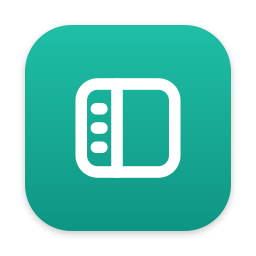
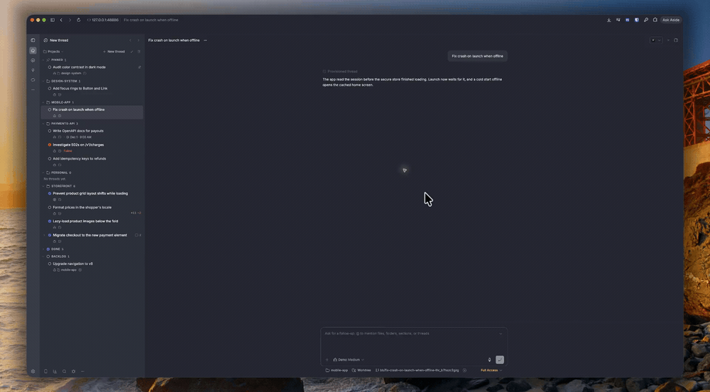
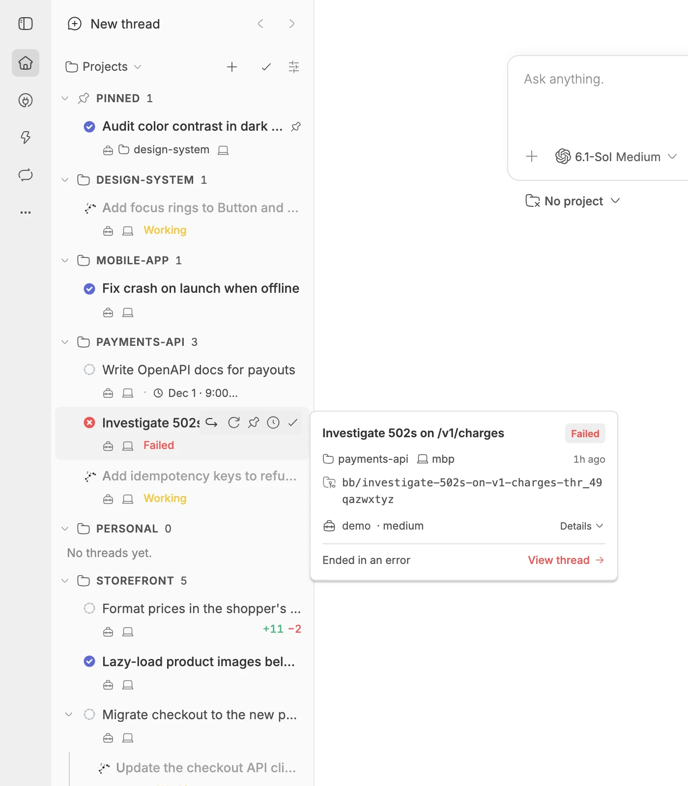
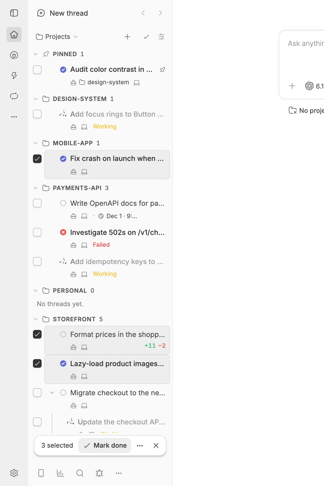

<p align="center">
  
</p>

<h1 align="center">Ultra Sidebar</h1>

<p align="center">
  <strong>A BB sidebar for running many threads at once.</strong>
</p>

<p align="center">
  <a href="#highlights">Highlights</a> ·
  <a href="#screenshots">Screenshots</a> ·
  <a href="#installation">Installation</a> ·
  <a href="#development">Development</a>
</p>

<p align="center">

</p>

Ultra Sidebar replaces BB's thread list. It groups threads by project or by status, keeps pinned work on top, nests subagents under the thread that started them, and puts each thread's pull request, branch and agent activity on its row.

## Highlights

- 🗂️ **Group by project or by status.** Status sorts threads into In progress, In review, Done, Backlog and Canceled. A merged pull request moves its thread to Done.
- 📌 **Pin, snooze or finish from the row.** Hover a row to pin it, snooze it until 9am tomorrow, or mark it done. A snoozed thread comes back early when it asks a question, fails or starts working.
- 🧬 **Subagents stay with their parent.** Child threads nest under the thread that spawned them, at any depth, and a collapsed parent shows how many it holds.
- 🔀 **Pull requests on every row.** Open, merged and closed pull requests show on the row, even after the thread's checkout is gone.
- ✅ **Act on many threads at once.** Select with ⌘-click or Shift-click, then move, finish or snooze them together. Undo and redo cover every change.
- ⌨️ **Keyboard first.** Alt+↑/↓ moves a row, and ⌘[ and ⌘] step back and forward through the threads you opened.
- 🤖 **Scriptable.** `bb sidebar` lists, files, snoozes and orders threads from a terminal.

## Screenshots

<p align="center">
  
  
</p>

## Installation

```sh
bb plugin install https://github.com/dillionverma/bb-plugin-ultra-sidebar
```

If BB keeps its own list, choose **Ultra Sidebar** in **Settings → Appearance → Sidebar**. Only one plugin can replace the thread list at a time.

Requires BB 0.46 or later. The [guide](GUIDE.md) covers statuses, bulk actions, undo, row details and every keyboard shortcut.

## Development

```sh
git clone https://github.com/dillionverma/bb-plugin-ultra-sidebar.git
cd bb-plugin-ultra-sidebar
npm ci
bb plugin install .
bb plugin dev
```

Run `npm test`, `npm run typecheck` and `bb plugin build` before submitting changes.

## License

[MIT](LICENSE).
